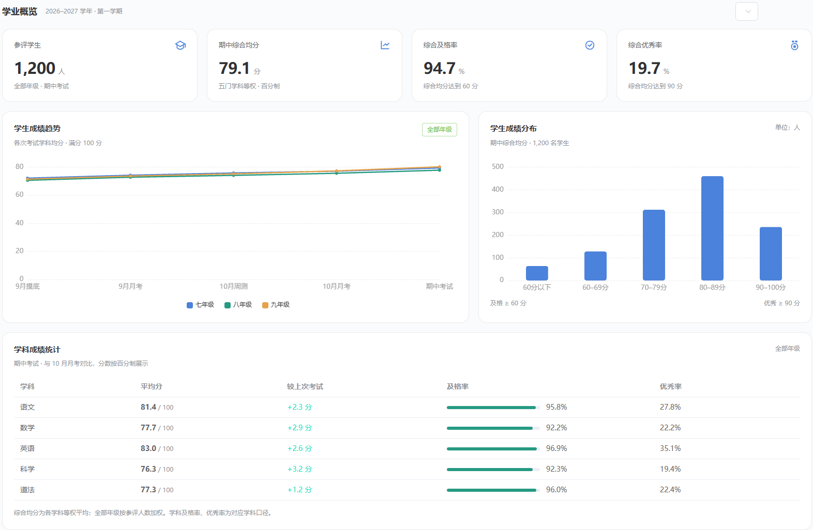
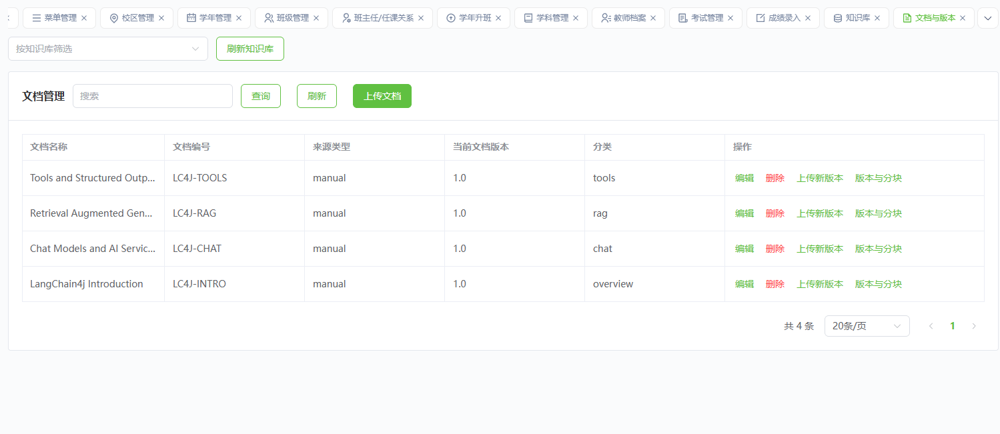
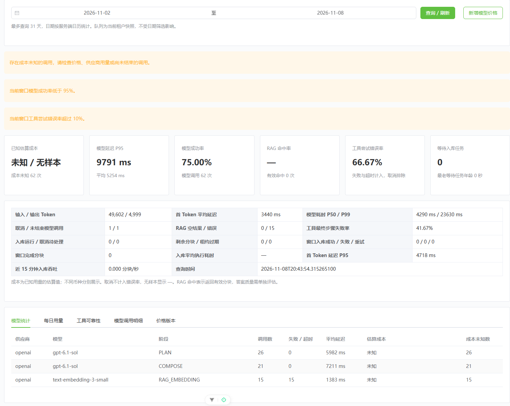
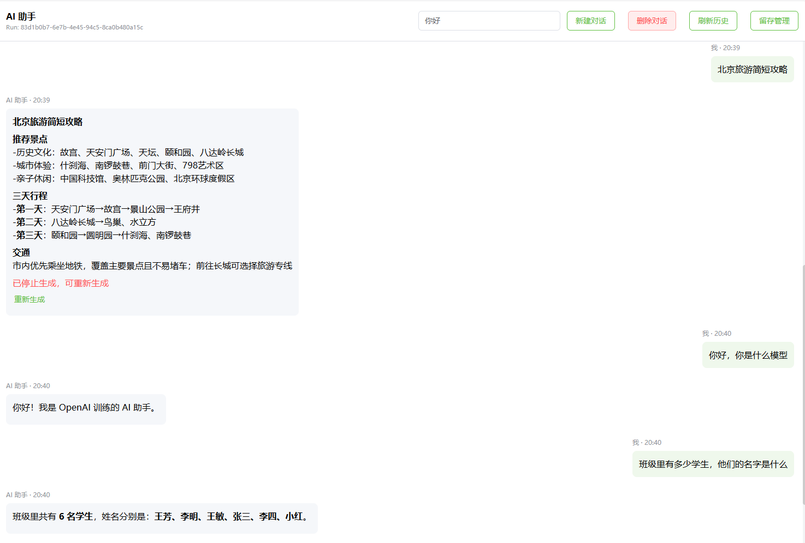
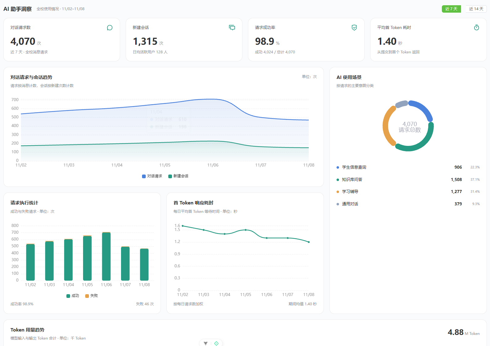
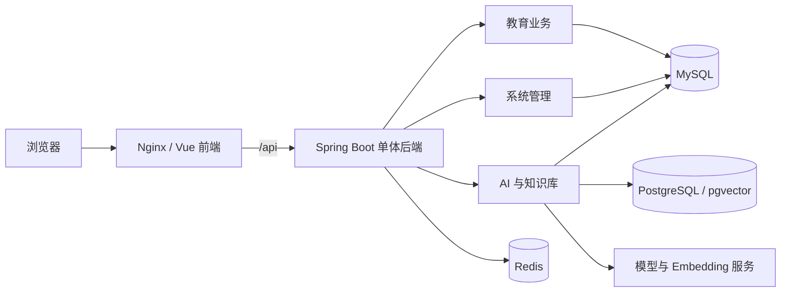

# NexusEdu

NexusEdu 是一个融合教育业务管理与 AI 辅助能力的前后端分离项目，面向学校日常管理场景，将学生档案、教学组织、教师任教、考试成绩与知识库、智能对话整合到同一管理平台。

项目采用 Vue 3 构建管理界面，使用 Java 21 与 Spring Boot 3.5 提供后端服务，通过关系数据库、向量检索和流式对话连接业务数据与 AI 应用。当前后端以单体应用部署，按教育、AI、知识库和系统管理等业务域组织代码。

## 核心功能

### 教育业务

| 功能 | 说明 |
| --- | --- |
| 学生管理 | 学生档案登记、查询与维护 |
| 教学组织 | 校区、学年、班级和学科管理 |
| 教师管理 | 教师档案登记与查询、班主任及任课关系分配 |
| 成绩管理 | 考试管理、学生成绩录入与查询 |
| 学年升班 | 升班方案预览、确认及批次查询 |

### AI 能力

- **智能对话**：支持会话管理、历史消息查询和 SSE 流式响应。
- **任务管理**：支持对话任务提交、运行状态查询、事件续接及取消。
- **知识库**：支持知识库与文档管理、文件上传、入库任务重试和取消、向量索引及检索。
- **配置治理**：提供 AI 配置版本、审核发布流程、灰度配置与策略管理入口。
- **评估与指标**：提供评估用例、评估批次及汇总查询，以及调用记录、指标概览和模型价格配置。

AI 功能需要配置可用的模型服务和 Embedding 服务；实际可用范围取决于模型配置、知识索引状态及当前用户权限。

### 系统管理

- 登录认证、JWT 访问令牌与刷新令牌。
- 用户、角色、菜单及按钮权限管理。
- 登录会话管理与基于权限的动态菜单。

## 项目预览

以下截图来自当前项目的演示环境，图片保存在 [`docs/images/`](docs/images/)。页面中的业务数据、AI 运行数据和成绩数据均用于功能展示，实际内容由当前租户、权限和数据库数据决定。

| 页面 | 体验内容 |
| --- | --- |
| [成绩分析](docs/images/score.png) | 查看年级成绩趋势、分数段分布、学科均分、及格率和优秀率 |
| [知识库文档管理](docs/images/knowledge.png) | 筛选知识库、上传文档、管理文档版本和分块 |
| [AI 模型运营](docs/images/ai_model.png) | 查看模型调用量、成功率、延迟、Token 和 RAG 运行指标 |
| [AI 对话](docs/images/ai_chat.png) | 使用流式对话、历史会话、重新生成和学生信息查询 |
| [AI 助手分析](docs/images/ai_assistant.png) | 查看请求趋势、使用场景、成功率、首 Token 耗时和 Token 用量 |

### 成绩分析



### 知识库文档管理



### AI 模型运营



### AI 对话



### AI 助手分析



菜单可见范围由账号权限决定；截图中可能包含演示账号、模型名称和统计样例，部署到实际环境前请替换或清理相关数据。

## 系统架构



MySQL 保存业务数据、系统配置及 AI 管理数据；PostgreSQL/pgvector 保存知识分块和向量；Redis 用于会话、缓存及 AI 流式事件等运行数据。文档上传文件通过独立数据卷持久化。

Docker Compose 统一管理数据库、Redis、后端和 Nginx 前端。开发环境由 Vite 将 `/api` 请求代理到本地后端。

## 技术栈

| 层次 | 技术 |
| --- | --- |
| 前端 | Vue 3、TypeScript、Vite 7、Element Plus、Pinia、Vue Router |
| 样式与可视化 | SCSS、Tailwind CSS、ECharts |
| 后端 | Java 21、Spring Boot 3.5、Spring Security、MyBatis-Plus |
| AI 集成 | LangChain4j、SSE、Embedding、向量检索 |
| 数据存储 | MySQL 8.4、PostgreSQL 16 / pgvector、Redis 7.4 |
| 构建与部署 | Maven Wrapper、pnpm、Docker Compose、Nginx |

数据库版本对应仓库提供的 Compose 配置。

## 目录结构

```text
NexusEdu/
├── backend/
│   ├── nexusedu-server/          # Spring Boot 后端
│   │   ├── src/main/java/        # 业务代码
│   │   ├── src/main/resources/   # 应用配置
│   │   └── src/test/             # 后端测试
│   └── doc/sql/                 # 数据库初始化和增量迁移
├── frontend/
│   └── nexusedu-web/            # Vue 管理前端
│       ├── src/                 # 页面、组件、路由、状态与请求封装
│       └── scripts/             # 开发辅助和局部验证脚本
├── deploy/                     # Dockerfile、Compose、Nginx 和部署脚本
├── pom.xml                     # 根 Maven 聚合配置
├── CHANGELOG.md                # 项目更新记录
└── README.md
```

## 快速开始

推荐先使用 Docker Compose 启动完整环境。在仓库根目录执行以下命令，要求已安装 Git、Docker 和 Docker Compose；Windows 使用启用 Linux containers 的 Docker Desktop。

**Windows / PowerShell**

```powershell
# 首次配置时执行；已有 deploy/.env 时直接编辑，避免覆盖现有配置。
Copy-Item deploy/.env.example deploy/.env
notepad deploy/.env

# 替换全部 replace-with- 占位值后启动。
Set-ExecutionPolicy -Scope Process Bypass
.\deploy\deploy.ps1 deploy
```

**Linux / Bash**

```bash
# 首次配置时执行；已有 deploy/.env 时直接编辑。
cp deploy/.env.example deploy/.env
chmod 600 deploy/.env
editor deploy/.env

# 替换全部 replace-with- 占位值后启动。
bash deploy/deploy.sh deploy
```

首次启动会构建前后端镜像、创建数据卷并初始化数据库。默认访问地址为 `http://localhost`，修改 `HTTP_PORT` 后使用对应端口。

全新数据库的开发种子账号为 `Admin / 123456`，首次登录后请修改密码。已有数据库的账号以实际数据为准。

启动后可检查服务状态和后端日志：

```powershell
.\deploy\deploy.ps1 status
.\deploy\deploy.ps1 logs backend
```

Linux 对应命令为 `bash deploy/deploy.sh status` 和 `bash deploy/deploy.sh logs backend`。服务器部署、回滚、备份与 SSH 隧道连接见 [部署文档](deploy/README.md)。

## 本地开发

### 环境准备

- JDK 21；后端可使用仓库自带 Maven Wrapper。
- Node.js >= 20.19.0，并满足 Vite 7 的运行要求；建议使用与 Docker 构建一致的 Node.js 22.12+。
- pnpm >= 8.8.0；仓库 Docker 构建使用 pnpm 9.15.5，建议保持一致。
- 已初始化的 MySQL、PostgreSQL/pgvector 和 Redis。

可复用快速开始创建的数据库容器。本地启动后端前先停止容器中的应用服务，避免两份后端同时处理任务：

```powershell
docker compose --env-file deploy/.env --env-file deploy/.deploy.env -f deploy/docker-compose.yml stop backend frontend
```

自行安装数据库时，需创建 MySQL 数据库 `nexus-edu`，依次导入 `backend/doc/sql/table_init.sql` 与 `backend/doc/sql/data_init.sql`；创建 PostgreSQL 数据库 `nexus_edu_knowledge` 并在其中执行 `backend/doc/sql/postgres_knowledge_chunk.sql`。

### 后端启动

在 `backend/nexusedu-server/.env` 中填写本地配置，例如：

```dotenv
SERVER_PORT=9090
NEXUSEDU_DATASOURCE_URL=jdbc:mysql://localhost:3306/nexus-edu?useSSL=false&serverTimezone=Asia/Shanghai&characterEncoding=utf8&allowPublicKeyRetrieval=true
NEXUSEDU_DATASOURCE_USERNAME=root
NEXUSEDU_DATASOURCE_PASSWORD=your-mysql-password
REDIS_HOST=localhost
REDIS_PORT=6379
REDIS_PASSWORD=your-redis-password
INTERNAL_RPC_SECRET=replace-with-at-least-32-random-bytes
JWT_SECRET=replace-with-at-least-32-random-bytes
KNOWLEDGE_VECTOR_STORE=postgres
KNOWLEDGE_POSTGRES_URL=jdbc:postgresql://localhost:5432/nexus_edu_knowledge
KNOWLEDGE_POSTGRES_USERNAME=nexusedu
KNOWLEDGE_POSTGRES_PASSWORD=your-postgres-password
EMBEDDING_ENDPOINT=https://your-provider.example/v1/embeddings
EMBEDDING_TOKEN=your-embedding-token
EMBEDDING_MODEL=your-embedding-model
EMBEDDING_DIMENSIONS=1536
OPENAI_API_KEY=your-model-provider-key
```

替换示例值；如果更改了数据库映射端口，同步调整连接地址。在仓库根目录执行：

```powershell
cd backend/nexusedu-server
.\mvnw.cmd spring-boot:run
```

Linux / macOS 在同一目录执行 `bash ./mvnw spring-boot:run`。后端默认监听 `9090`。

后端通过 Spring 配置导入读取模块目录或当前工作目录的 `.env`，**不会自动读取 `deploy/.env`**。IDE 启动时可将工作目录设为后端模块目录，或在运行配置中注入环境变量。后端 `.env` 按 Java properties 解析，值无需添加 shell 引号。

### 前端启动

在新的终端中，从仓库根目录执行：

```powershell
cd frontend/nexusedu-web
corepack enable
corepack prepare pnpm@9.15.5 --activate
pnpm install --frozen-lockfile
# 仅首次配置时复制，已有 .env 时直接编辑。
Copy-Item .env.example .env
pnpm dev
```

Linux / macOS 将复制命令替换为 `cp .env.example .env`。

前端默认开发地址为 `http://localhost:3006`，实际地址以 Vite 输出为准。保持 `VITE_API_URL=/`，通过 `VITE_API_PROXY_URL=http://localhost:9090` 指向本地后端。前端变量会进入浏览器构建产物，不要在其中填写模型密钥或数据库密码。

## 配置说明

部署配置从 [deploy/.env.example](deploy/.env.example) 开始；本地后端配置以 [application.yml](backend/nexusedu-server/src/main/resources/application.yml) 为准。

| 配置 | 用途 |
| --- | --- |
| `MYSQL_ROOT_PASSWORD`、`POSTGRES_PASSWORD`、`REDIS_PASSWORD` | Compose 数据服务密码 |
| `NEXUSEDU_DATASOURCE_*` | 本地后端的 MySQL 连接配置 |
| `KNOWLEDGE_POSTGRES_*` | 后端知识向量库连接配置 |
| `INTERNAL_RPC_SECRET`、`JWT_SECRET` | 内部调用签名和认证密钥，使用不少于 32 字节的随机值 |
| `OPENAI_API_KEY` | 模型调用凭据；种子模型配置引用此环境变量 |
| `EMBEDDING_ENDPOINT`、`EMBEDDING_TOKEN`、`EMBEDDING_MODEL` | 文本向量化服务地址、凭据与模型名称 |
| `EMBEDDING_DIMENSIONS` | 向量维度，默认 `1536`，须与模型输出和数据库向量列一致 |
| `HTTP_PORT` | Compose 前端对外 HTTP 端口，默认 `80` |
| `MYSQL_PORT`、`POSTGRES_PORT`、`REDIS_PORT` | Compose 数据服务映射端口，仅绑定宿主机回环地址 |
| `VITE_API_URL`、`VITE_API_PROXY_URL` | 前端 API 地址及开发代理目标 |

模型配置还包含服务 `baseUrl`、模型名称和密钥环境变量名称；使用 AI 前应核对数据库种子配置及已发布的配置版本，确保与所用服务一致。仅设置 `OPENAI_API_KEY` 不会自动替换模型服务地址。

Compose 会将部署变量转换为后端连接配置；本地运行时需自行填写对应变量。MySQL 初始化和 PostgreSQL 初始化只在全新数据卷首次启动时执行；已有环境按 [数据库迁移说明](backend/doc/sql/migrations/README.md) 处理。修改 `.env` 不会自动改变已有数据库账号密码。

实际 `.env`、访问令牌和数据库备份不应提交到版本控制。
p
## 文档导航

| 文档 | 内容 |
| --- | --- |
| [部署文档](deploy/README.md) | Windows/Linux 部署、日志、回滚、备份与 SSH 隧道 |
| [部署配置示例](deploy/.env.example) | Compose 配置项及默认值 |
| [后端配置](backend/nexusedu-server/src/main/resources/application.yml) | 后端环境变量、线程池和 AI 参数 |
| [数据库初始化](backend/doc/sql/) | MySQL 及 PostgreSQL 初始化脚本 |
| [数据库迁移](backend/doc/sql/migrations/README.md) | 已有环境的增量迁移约定 |
| [前端模板说明](frontend/nexusedu-web/README.zh-CN.md) | Art Design Pro 原始模板介绍，项目业务以根 README 为准 |
| [更新日志](CHANGELOG.md) | 项目变更记录 |


## 许可与致谢

前端基于 Art Design Pro 构建，感谢其提供的管理界面、主题及组件基础。前端目录保留了原模板的 [MIT 许可证](frontend/nexusedu-web/LICENSE)，使用和分发相关代码时应保留原版权与许可声明。


